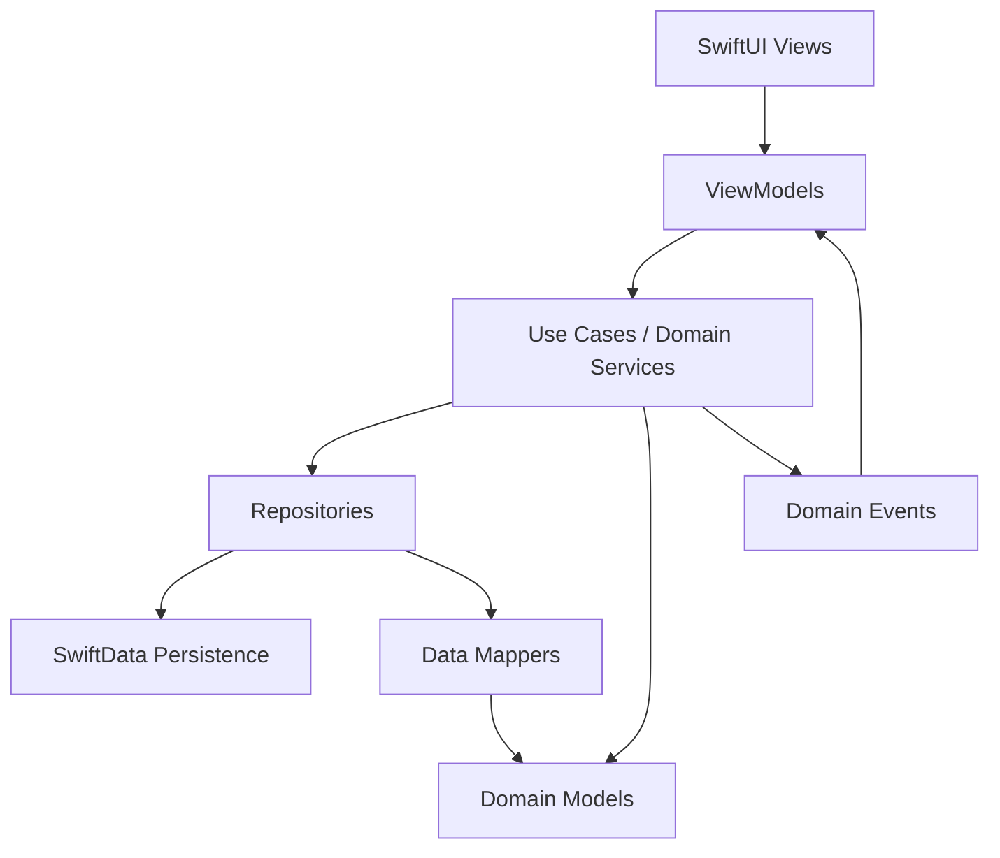
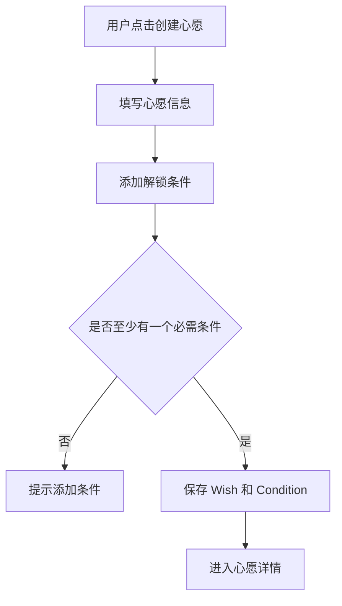
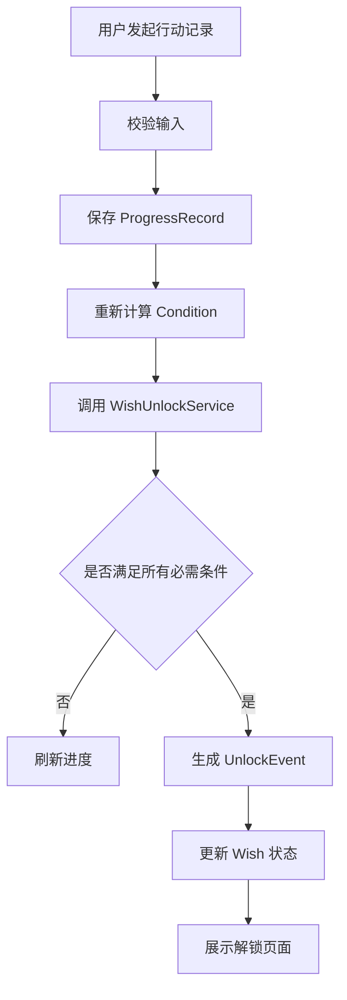
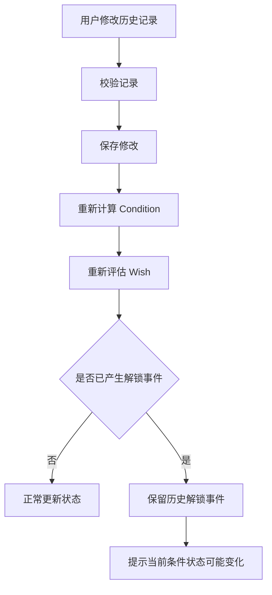

# WishEarn — iOS 技术架构设计文档（ARCHITECTURE）

**版本：** V1.1  
**适用阶段：** MVP  
**技术平台：** iOS 17+  
**技术栈：** Swift + SwiftUI + SwiftData  
**架构模式：** MVVM + Repository + Domain Service  
**数据策略：** Local-first

**版本记录：** V1.1 按 [DECISIONS.md](../DECISIONS.md) 补充 `WishPausePeriod`、移除 `ConditionStatus` / `weight`、明确 STREAK 暂停冻结语义。

---

# 1. 架构目标

## 1.1 核心目标

本项目采用轻量、分层、可扩展的架构。

MVP 阶段不引入不必要的复杂度，但必须保证：

1. UI 与业务逻辑分离。
2. 数据模型与业务规则分离。
3. 进度计算具有统一入口。
4. 心愿解锁具有统一入口。
5. 业务规则可以独立进行单元测试。
6. 本地数据持久化可靠。
7. 后续能够平滑接入 iCloud、云端同步和 AI 功能。

## 1.2 架构原则

- Separation of Concerns：每一层有明确职责。
- Single Source of Truth：每类业务数据只有一个可信来源。
- Domain-driven Design：核心业务规则集中在领域服务。
- Testability：业务逻辑尽量不依赖 SwiftUI 和 SwiftData。
- Local-first：本地数据是 MVP 阶段的唯一数据来源。
- Incremental Evolution：为后续扩展预留接口，但不提前建设复杂系统。

---

# 2. 整体架构

## 2.1 分层架构



各层职责：

| 层级 | 职责 |
|---|---|
| Presentation | 页面、组件、用户交互 |
| ViewModel | 页面状态、调用业务用例 |
| Domain | 核心业务规则和模型 |
| Repository | 数据访问抽象 |
| Persistence | SwiftData 持久化实现 |
| Infrastructure | 图片存储、通知等系统能力 |

## 2.2 依赖方向

依赖应该从外向内。

Presentation 可以依赖 Domain。

Domain 不应该依赖 SwiftUI。

Domain 不应该直接依赖 SwiftData。

Repository Protocol 定义在业务层，具体实现放在 Infrastructure 或 Persistence 层。

禁止以下做法：

- 在 View 中直接操作 ModelContext。
- 在 ViewModel 中实现复杂解锁算法。
- 在 SwiftData Model 中放置完整的业务工作流。
- 在多个地方重复实现进度计算。

---

# 3. 项目目录结构

建议采用以下目录：

```text
WishEarn/
├── App/
│   ├── WishEarnApp.swift
│   ├── AppContainer.swift
│   ├── AppRouter.swift
│   └── AppDependencies.swift
│
├── Domain/
│   ├── Entities/
│   │   ├── Wish.swift
│   │   ├── Condition.swift
│   │   ├── ProgressRecord.swift
│   │   ├── UnlockEvent.swift
│   │   └── WishPausePeriod.swift
│   │
│   ├── Enums/
│   │   ├── WishStatus.swift
│   │   ├── ConditionType.swift
│   │   ├── AmountDirection.swift
│   │   └── ProgressUnit.swift
│   │
│   ├── ValueObjects/
│   │   ├── ProgressSnapshot.swift
│   │   ├── Money.swift
│   │   └── DateRange.swift
│   │
│   ├── Repositories/
│   │   ├── WishRepository.swift
│   │   ├── ConditionRepository.swift
│   │   └── ProgressRepository.swift
│   │
│   └── Services/
│       ├── ProgressCalculator.swift
│       ├── StreakCalculator.swift
│       ├── WishUnlockService.swift
│       └── WishLifecycleService.swift
│
├── Data/
│   ├── Models/
│   │   ├── WishEntity.swift
│   │   ├── ConditionEntity.swift
│   │   ├── ProgressRecordEntity.swift
│   │   └── UnlockEventEntity.swift
│   │
│   ├── Repositories/
│   │   ├── SwiftDataWishRepository.swift
│   │   ├── SwiftDataConditionRepository.swift
│   │   └── SwiftDataProgressRepository.swift
│   │
│   ├── Mappers/
│   └── Database/
│       ├── ModelContainerFactory.swift
│       └── SchemaMigrationPlan.swift
│
├── Presentation/
│   ├── Navigation/
│   ├── Components/
│   ├── WishList/
│   ├── WishDetail/
│   ├── WishEditor/
│   ├── ConditionEditor/
│   ├── Today/
│   ├── Achievements/
│   └── Settings/
│
├── Infrastructure/
│   ├── ImageStorage/
│   ├── Notifications/
│   ├── Analytics/
│   └── Export/
│
├── Resources/
│
└── Tests/
    ├── DomainTests/
    ├── RepositoryTests/
    ├── ViewModelTests/
    └── IntegrationTests/
```

说明：

MVP 可以适当合并文件，避免过度拆分。

但必须保留 Presentation、Domain、Data、Infrastructure 四个主要职责边界。

---

# 4. 核心领域模型

## 4.1 Wish

Wish 表示用户的一个心愿。

核心字段：

```swift
enum WishStatus: String, Codable {
    case active
    case unlocked
    case completed
    case paused
    case archived
}
```

核心属性：

- id: UUID
- title: String
- description: String?
- imagePath: String?
- targetPrice: Decimal?
- currencyCode: String
- targetDate: Date?
- status: WishStatus
- createdAt: Date
- updatedAt: Date
- unlockedAt: Date?
- completedAt: Date?

关系：

Wish 1:N Condition

Wish 1:N UnlockEvent

约束：

- 一个 Wish 可以没有 Condition，但没有必需条件时不能自动解锁。
- 删除 Wish 时必须处理所有关联数据。
- COMPLETED 是终态。
- PAUSED 可以恢复为 ACTIVE。
- ARCHIVED 不再参与日常行动汇总。

## 4.2 Condition

Condition 表示心愿的一个解锁条件。

```swift
enum ConditionType: String, Codable {
    case streak
    case count
    case duration
    case amount
    case checkpoint
    case custom
}
```

```swift
enum AmountDirection: String, Codable {
    case income
    case saving
    case other
}
```

核心属性：

- id: UUID
- wishID: UUID
- title: String
- description: String?
- type: ConditionType
- targetValue: Decimal
- unit: String?
- amountDirection: AmountDirection?
- isRequired: Bool
- sortOrder: Int
- createdAt: Date

Condition 本身不直接存储可随意修改的 currentValue。

当前值通过 ProgressRecord 计算获得。

如果未来为了性能增加缓存字段，必须保证能够重新计算恢复。

MVP 不包含 `weight` 字段（见 DECISIONS.md ADR-005）；所有条件默认必需且权重相同，使用 `sortOrder` 控制展示顺序。

## 4.3 ProgressRecord

表示用户实际完成的一次行动。

核心属性：

- id: UUID
- conditionID: UUID
- value: Decimal
- note: String?
- recordedAt: Date
- createdAt: Date
- updatedAt: Date

约束：

- 一条记录只能属于一个 Condition。
- 记录必须有明确的时间。
- 记录修改和删除必须触发进度重新计算。
- STREAK 每个自然日最多允许一条有效完成记录。

## 4.4 UnlockEvent

建议在 MVP 中就引入解锁事件。

它用于记录心愿第一次达到解锁条件的历史事实。

核心字段：

- id: UUID
- wishID: UUID
- unlockedAt: Date
- conditionSnapshot: String
- createdAt: Date

conditionSnapshot 用于保留解锁时的条件摘要。

这样即使用户后续修改条件，也不会丢失当时解锁的依据。

## 4.5 WishPausePeriod

记录心愿的一次暂停区间，用于在计算 STREAK 时跳过暂停期间的自然日。

核心字段：

- id: UUID
- wishID: UUID
- startedAt: Date
- endedAt: Date?（暂停进行中为 nil）

约束：

- 一次暂停对应一个区间，恢复时写入 endedAt。
- 同一心愿可以有多条历史暂停区间。
- 暂停区间是 STREAK 计算的事实来源之一，不得依赖 Condition 上的临时缓存。
- 删除心愿时必须一并删除其暂停区间。

---

# 5. 核心业务服务设计

所有核心业务逻辑集中在 Domain Services。

## 5.1 ProgressCalculator

职责：

统一计算条件的当前进度。

输入：

- Condition
- [ProgressRecord]
- 当前日期和时区上下文

输出：

ProgressSnapshot。

建议结构：

```swift
struct ProgressSnapshot {
    let currentValue: Decimal
    let targetValue: Decimal
    let progressRatio: Double
    let isCompleted: Bool
    let remainingValue: Decimal
    let lastRecordedAt: Date?
}
```

不同 ConditionType 使用不同计算方式。

| 类型 | 计算方法 |
|---|---|
| COUNT | 有效记录值求和 |
| DURATION | 有效时长求和 |
| AMOUNT | 有效金额求和 |
| STREAK | 当前连续完成天数 |
| CHECKPOINT | 完成状态 |
| CUSTOM | 根据自定义记录规则计算 |

注意：

progressRatio 必须限制在 0 到 1 之间。

实际完成判断不能只依赖 progressRatio。

必须比较真实数值与目标值。

## 5.2 StreakCalculator

这是相对复杂的业务模块。

建议独立实现，不要和普通累计计算混合。

核心输入：

- 所有有效打卡记录。
- 当前日期。
- 用户时区。
- 目标连续天数。

输出：

- 当前连续天数。
- 历史最长连续天数。
- 是否完成。
- 最近打卡日期。

业务规则：

1. 使用用户本地时区的自然日。
2. 一天最多计算一次。
3. 当天完成后连续天数增加。
4. 中断后当前连续周期重置。
5. 暂停期间不产生打卡要求，也不视为中断。
6. 恢复后继续暂停前的连续周期，跳过暂停区间覆盖的自然日（见 DECISIONS.md ADR-001）。
7. 暂停区间内的打卡不延长、不打断连续天数。
8. 修改历史记录后重新计算。

特别注意：

不能简单使用 Date 相减后除以 86400 来判断自然日间隔。

应该使用 Calendar 的日期计算能力，处理夏令时和时区边界。

## 5.3 WishUnlockService

职责：

统一判断一个心愿是否应该解锁。

核心接口：

```swift
func evaluateUnlock(
    wishID: UUID
) throws -> UnlockResult
```

处理流程：

1. 获取心愿。
2. 检查心愿状态。
3. 获取所有必需条件。
4. 计算每个条件的真实完成状态。
5. 检查是否存在必需条件未完成。
6. 如果全部完成，生成 UnlockEvent。
7. 更新 Wish 状态。
8. 保存数据。

重要规则：

- 没有必需条件时不解锁。
- 已经解锁时不能重复生成事件。
- 已兑现的心愿不能重新进入解锁流程。
- 暂停和归档的心愿不自动解锁。
- 所有解锁操作必须保证幂等性。

## 5.4 WishLifecycleService

负责管理心愿生命周期。

主要接口：

```swift
func createWish(...)
func updateWish(...)
func pauseWish(...)
func resumeWish(...)
func archiveWish(...)
func completeWish(...)
```

禁止 ViewModel 直接修改 Wish.status 来实现状态转换。

状态变化必须经过统一服务。

---

# 6. 核心业务流程

## 6.1 创建心愿流程



## 6.2 打卡流程



## 6.3 修改历史记录流程



---

# 7. Repository 设计

## 7.1 Repository Protocol

Domain 层定义数据访问接口。

例如：

```swift
protocol WishRepository {
    func fetchWish(id: UUID) throws -> Wish?
    func fetchAllWishes() throws -> [Wish]
    func save(_ wish: Wish) throws
    func delete(id: UUID) throws
}
```

ConditionRepository：

```swift
protocol ConditionRepository {
    func fetchConditions(
        wishID: UUID
    ) throws -> [Condition]

    func save(_ condition: Condition) throws

    func delete(id: UUID) throws
}
```

ProgressRepository：

```swift
protocol ProgressRepository {
    func fetchRecords(
        conditionID: UUID
    ) throws -> [ProgressRecord]

    func save(_ record: ProgressRecord) throws

    func delete(id: UUID) throws
}
```

实际项目中可以根据 SwiftData 的使用方式调整协议。

## 7.2 SwiftData 实现

在 Data 层实现具体 Repository。

要求：

- 所有数据库操作集中管理。
- 避免多个 Repository 各自创建独立数据库容器。
- 对涉及多个实体的业务操作提供事务边界。
- 使用唯一标识符建立关系。
- 对查询添加合理谓词，避免全量读取。

## 7.3 数据映射

建议在 Domain Model 和 SwiftData Entity 之间建立明确映射。

这样未来替换持久化实现时，不需要修改业务规则。

如果 MVP 开发过程中采用 SwiftData Model 兼任领域模型，也必须限制 SwiftData 相关依赖不能进入业务计算核心。

---

# 8. ViewModel 设计

每个主要页面对应一个 ViewModel。

例如：

WishListViewModel：

负责：

- 获取心愿列表。
- 处理状态筛选。
- 创建和删除操作。
- 暴露页面状态。

WishDetailViewModel：

负责：

- 加载心愿详情。
- 加载条件。
- 展示进度。
- 调用记录服务。
- 响应解锁事件。

TodayViewModel：

负责：

- 获取今日行动。
- 展示待完成条件。
- 快速打卡。
- 更新页面状态。

ViewModel 不应该：

- 自己计算复杂的连续打卡。
- 自己判断心愿是否解锁。
- 直接编写复杂数据库查询。
- 直接管理 SwiftData ModelContext。

推荐使用：

```swift
@MainActor
@Observable
final class WishListViewModel {
    private let wishRepository: WishRepository

    private(set) var wishes: [Wish] = []
    private(set) var isLoading = false
    private(set) var errorMessage: String?

    init(wishRepository: WishRepository) {
        self.wishRepository = wishRepository
    }
}
```

---

# 9. 依赖注入

通过 AppContainer 统一管理依赖。

建议：

```swift
@MainActor
final class AppContainer {
    let wishRepository: WishRepository
    let conditionRepository: ConditionRepository
    let progressRepository: ProgressRepository

    let progressCalculator: ProgressCalculator
    let streakCalculator: StreakCalculator
    let unlockService: WishUnlockService
}
```

App 初始化时创建依赖。

ViewModel 通过构造函数注入所需依赖。

测试环境可以使用 Mock Repository。

不要在 ViewModel 内部直接创建具体 Repository 实例。

---

# 10. 持久化与数据一致性

## 10.1 数据库

MVP 使用 SwiftData。

数据库只负责数据持久化，不负责决定业务状态。

## 10.2 事务

以下操作必须保证数据一致性：

- 创建心愿及条件。
- 删除心愿及关联数据。
- 删除条件及关联记录。
- 添加记录并触发进度更新。
- 心愿解锁。
- 奖励兑现。
- 暂停 / 恢复心愿并维护 WishPausePeriod。

涉及多个实体的修改应使用明确的事务或统一的写入服务。

## 10.3 解锁事件

UnlockEvent 采用只追加的历史事件思路。

一旦生成，不应该因为后续修改条件而静默删除。

用户修改历史记录导致当前条件不再满足时：

- 保留原始解锁时间。
- 保留解锁时的条件快照。
- 展示当前条件状态变化。
- 不自动撤销已经发生的奖励兑现。

## 10.4 图片存储

不要直接把大尺寸图片二进制长期存放在普通模型字段中。

建议：

1. 图片选择后允许自由裁剪，默认展示完整原图，可自由调整裁剪范围。
2. 裁剪后压缩。
3. 存储在 App 沙盒。
4. 数据库仅存储相对路径。
5. 删除心愿时清理对应图片。
6. 图片加载失败时显示默认占位图。

---

# 11. 并发与错误处理

MVP 主要是本地单用户应用。

仍需遵循：

- 数据库写操作统一管理。
- UI 更新在 MainActor。
- 避免后台任务与 UI 共享可变状态。
- 避免重复点击产生重复记录。
- 关键写操作完成后再刷新 UI。

错误分类：

| 错误 | 处理 |
|---|---|
| 数据不存在 | 提示数据可能已删除 |
| 参数不合法 | 阻止提交 |
| 数据库写入失败 | 提示重试 |
| 图片加载失败 | 使用占位图 |
| 条件计算失败 | 保留原始记录，提示刷新 |
| 解锁失败 | 不展示成功动画，提示重试 |

不能捕获错误后直接忽略。

---

# 12. 测试架构

## 12.1 Domain Unit Tests

优先测试：

- ProgressCalculator。
- StreakCalculator。
- WishUnlockService。
- WishLifecycleService。

这些模块不应该依赖真实数据库。

## 12.2 Repository Tests

使用临时 SwiftData ModelContainer。

测试：

- 创建和读取。
- 修改和删除。
- 关系查询。
- 数据迁移。
- 事务失败处理。

## 12.3 ViewModel Tests

测试：

- 加载状态。
- 空状态。
- 错误状态。
- 创建流程。
- 打卡后的 UI 状态变化。

## 12.4 Integration Tests

重点验证完整链路：

创建心愿 → 添加条件 → 记录行动 → 条件达成 → 心愿解锁 → 兑现奖励。

## 12.5 核心测试覆盖要求

第一版建议：

- 核心业务算法 100% 覆盖关键分支。
- Domain 层关键业务逻辑具备单元测试。
- Repository 的 CRUD 和关系操作具备测试。
- 关键用户流程至少有集成测试。

不要单纯追求代码覆盖率数字。

---

# 13. 后续扩展设计

以下能力只预留扩展点，不在 MVP 实现。

## 13.1 iCloud 同步

未来可以增加：

CloudSyncService。

本地数据继续作为主要访问接口。

需要额外设计：
- 多设备冲突处理。
- 数据版本。
- 删除同步。
- 离线修改合并。

## 13.2 HealthKit

未来通过 HealthKit 获取运动数据。

数据进入统一的 ProgressRecord 创建流程。

不能让 HealthKit 直接修改 Condition 状态。

## 13.3 AI 目标助手

未来可以增加：

GoalAssistantService。

负责：
- 将愿望拆解成可执行条件。
- 推荐目标数量。
- 推荐合理的完成周期。
- 帮助用户生成行动计划。

AI 输出必须经过用户确认才能创建实际 Condition。

## 13.4 Widget

展示：
- 当前心愿。
- 总体进度。
- 今日行动。

Widget 只展示数据，不负责核心业务计算。

---

# 14. 架构验收清单

在进入完整 UI 开发之前，至少完成以下工作：

- [ ] 建立四层架构。
- [ ] 定义 Wish、Condition、ProgressRecord。
- [ ] 定义 UnlockEvent。
- [ ] 定义 WishPausePeriod。
- [ ] 定义所有枚举。
- [ ] 建立 Repository Protocol。
- [ ] 建立 SwiftData Repository。
- [ ] 实现 ProgressCalculator。
- [ ] 实现 StreakCalculator。
- [ ] 实现 WishUnlockService。
- [ ] 实现 WishLifecycleService。
- [ ] 实现依赖注入。
- [ ] 配置测试环境。
- [ ] 完成核心业务单元测试。
- [ ] 验证数据持久化。

---

# 15. 给 AI Coding 的最终架构约束

以下约束优先级高于 AI 自行选择的实现偏好。

1. 不允许将核心业务计算写入 SwiftUI View。
2. 不允许在多个模块重复实现条件进度计算。
3. 不允许在多个模块重复实现心愿解锁逻辑。
4. 不允许通过直接修改 currentValue 替代历史记录。
5. 不允许忽略历史记录修改后的重新计算。
6. 不允许已发生的解锁事件被静默删除。
7. 不允许 COMPLETED 状态被普通进度更新覆盖。
8. 不允许使用 Double 进行金额累计。
9. 不允许将时区和自然日计算简单化为固定 86400 秒。
10. 不允许为了未来功能提前引入复杂后端架构。

**最终架构目标：用尽量简单的工程实现，可靠地承载 WishEarn 的核心业务闭环。**
