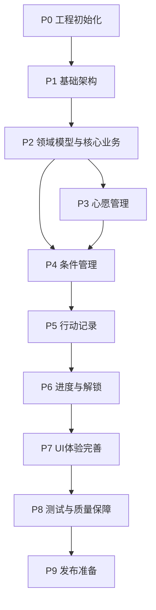

# WishEarn — 开发实施计划（DEVELOPMENT_PLAN）

**版本：** V1.2
**项目阶段：** Phase 9 — 发布准备（Phase 2 UI 改版已完成，RC 验收中）
**关联文档：** PRD.md、ARCHITECTURE.md、DECISIONS.md  
**开发方式：** AI-assisted Development  
**技术栈：** Swift + SwiftUI + SwiftData  
**最低系统版本：** iOS 17  
**开发原则：** 小步开发、持续编译、自动化测试、阶段验收

**版本记录：** V1.1 按 [DECISIONS.md](../DECISIONS.md) 增加 TASK-209（WishPausePeriod），调整 TASK-201（移除 ConditionStatus）、TASK-306（暂停区间）、TASK-507（CUSTOM 数值累计）、TASK-602（STREAK 暂停冻结）。V1.2 补充 Phase 2 UI 改版完成状态、RC 验收结果与发布阻塞项。

---

# 目录

1. 开发总体规划
2. 项目任务依赖关系
3. Phase 0：开发环境与工程初始化
4. Phase 1：基础架构建设
5. Phase 2：领域模型与核心业务
6. Phase 3：心愿管理
7. Phase 4：条件管理
8. Phase 5：行动记录系统
9. Phase 6：进度计算与心愿解锁
10. Phase 7：核心 UI 与交互完善
11. Phase 8：测试与质量保障
12. Phase 9：发布准备
13. 开发任务跟踪机制
14. AI Coding 工作规范
15. MVP 最终验收清单

---

# 1. 开发总体规划

## 1.1 开发目标

完成一个真正可安装、可使用的 iOS App。

用户能够完成以下完整流程：

1. 创建自己的心愿。
2. 为心愿添加自定义条件。
3. 每天记录自己完成的行动。
4. 查看各项条件的完成进度。
5. 在全部必要条件完成后自动解锁心愿。
6. 通过解锁页面获得成就感。
7. 记录自己已经兑现的奖励。

## 1.2 开发阶段

| 阶段 | 名称 | 优先级 |
|---|---|---|
| P0 | 工程初始化 | 必须 |
| P1 | 基础架构 | 必须 |
| P2 | 领域模型与核心业务 | 必须 |
| P3 | 心愿管理 | 必须 |
| P4 | 条件管理 | 必须 |
| P5 | 行动记录 | 必须 |
| P6 | 进度计算与解锁 | 必须 |
| P7 | UI 与体验完善 | 必须 |
| P8 | 测试与质量保障 | 必须 |
| P9 | 发布准备 | 必须 |

开发顺序以业务依赖为准，不建议为了尽早看到页面而跳过数据模型和业务逻辑。

### 1.4 当前执行状态补充（2026-11-10）

- MVP P0–P9 已实现并进入发布准备。
- Phase 2 UI 改版已完成：设计系统 #8、首页 #9、详情 #10、Today #11、Editors #12、Unlock / Achievements / Settings #13，以及后续主图比例 #20、Playful Editorial 配色 #21。
- 当前测试基线为 **295 项单元 / 集成 + 2 项 UI 测试**，Playful Editorial 七个核心页面 Light / Dark 截图已归档。
- Issue #22 RC 验收：自动化回归、Release Archive / IPA 已完成；GitHub Actions billing 阻塞、真机交互未验收，当前结论为 **NO-GO**。
- 历史阶段记录保留；不以本文档替代 [PROJECT_STATUS.md](../PROJECT_STATUS.md) 的实际验证状态。

## 1.3 工作量估计

以 AI Coding 为主要开发方式，开发者负责需求确认、代码审查、运行和测试。

| 阶段 | 预计工作量 |
|---|---:|
| P0 | 0.5 天 |
| P1 | 1–2 天 |
| P2 | 2–3 天 |
| P3 | 1–2 天 |
| P4 | 1–2 天 |
| P5 | 2–3 天 |
| P6 | 2–3 天 |
| P7 | 3–4 天 |
| P8 | 2–3 天 |
| P9 | 1–2 天 |

预计总计：15–25 个有效开发日。

以上是初步工程估计，不是交付承诺。实际时间取决于 AI Coding 工具、开发者经验以及测试和返工情况。

---

# 2. 项目任务依赖关系



说明：

P3 和 P4 在数据模型稳定后可以部分并行开发，但必须统一接口。

P5 依赖条件模型。

P6 依赖行动记录和进度计算。

P7 可以提前进行视觉设计，但最终交互必须基于已实现的业务接口。

---

# 3. Phase 0：开发环境与工程初始化

**目标：建立可持续开发的基础工程。**

## TASK-000：准备开发环境

工作内容：

- 安装并配置 Xcode。
- 准备 iOS Simulator。
- 创建 Apple Developer 开发环境（如需要真机签名）。
- 确认 Swift 和 iOS SDK 版本。
- 准备 Git 仓库。

交付物：

- 可用的 Xcode 开发环境。
- Git 仓库。
- 基础项目说明。

验收标准：

- 可以创建并运行一个最简单的 SwiftUI App。
- 可以在模拟器中启动。

## TASK-001：创建项目工程

工作内容：

- 创建 WishEarn iOS 工程。
- 配置 Bundle Identifier。
- 配置最低 iOS 版本为 17。
- 配置 Swift 语言版本。
- 设置应用名称和图标占位。
- 配置开发和测试 Scheme。

交付物：

- WishEarn.xcodeproj。
- 基础 App 入口。

验收标准：

- 工程能够正常编译。
- 模拟器能够正常启动。
- 没有明显编译警告。

---

# 4. Phase 1：基础架构建设

**目标：建立稳定的项目结构和依赖管理机制。**

## TASK-101：建立目录结构

工作内容：

建立以下目录：

- App
- Domain
- Data
- Presentation
- Infrastructure
- Resources
- Tests

创建基础占位文件。

验收标准：

- 目录符合 ARCHITECTURE.md。
- 不出现职责混乱。
- 编译通过。

## TASK-102：建立 App 入口与导航

工作内容：

- 实现 WishEarnApp。
- 实现 AppContainer。
- 实现底部 Tab 导航。
- 建立四个主页面占位。

四个 Tab：

1. 心愿。
2. 行动。
3. 成就。
4. 我的。

验收标准：

- Tab 可以正常切换。
- 页面导航状态正确。
- 页面之间不存在不必要的数据耦合。

## TASK-103：建立依赖注入

工作内容：

- 实现 AppContainer。
- 注册 Repository。
- 注册 Domain Service。
- 提供测试环境依赖替换能力。

验收标准：

- ViewModel 通过构造函数获取依赖。
- ViewModel 不自行创建 Repository。
- 可以使用 Mock Repository 进行测试。

说明：Phase 1 先建立 `AppContainer`、`AppDependencies` 与构造函数注入模式；Repository / Domain Service 的具体协议与注册在 Phase 2 定义后接入。

## TASK-104：建立统一错误处理

工作内容：

- 定义 AppError。
- 定义 DomainError。
- 定义 PersistenceError。
- 建立错误展示机制。

验收标准：

- 业务异常能够被识别。
- UI 能够展示合理提示。
- 不允许静默吞掉关键错误。

## TASK-105：建立基础设计系统

工作内容：

统一定义：

- 颜色。
- 字体。
- 圆角。
- 间距。
- 按钮样式。
- 卡片样式。
- 状态标签。

验收标准：

- 页面不直接散落大量颜色和尺寸硬编码。
- 支持 Light / Dark Mode。

Phase 1 Gate：

- [x] 工程可编译。
- [x] 四个 Tab 可运行。
- [x] 依赖注入可用。
- [x] 错误处理机制建立。
- [x] 基础设计系统建立。

---

# 5. Phase 2：领域模型与核心业务

**目标：优先完成整个 App 最重要的业务基础。**

这一阶段尽量不开发复杂 UI。

## TASK-201：实现领域枚举

实现：

- WishStatus。
- ConditionType。
- AmountDirection。
- ProgressUnit。

说明：不实现持久化的 ConditionStatus 枚举（见 DECISIONS.md ADR-005），条件状态由 ProgressCalculator 根据记录实时派生。

验收标准：

- 枚举含义与 PRD 一致。
- 数据存储值稳定。
- 枚举转换存在明确的兼容处理。

## TASK-202：实现 Wish Domain Model

字段按照 ARCHITECTURE.md 定义。

实现：

- 初始化。
- 基础属性更新。
- 状态读取。
- 必要的领域校验。

验收标准：

- 必填字段校验正确。
- 状态值有效。
- 不依赖 SwiftUI。

## TASK-203：实现 Condition Domain Model

实现：

- 条件初始化。
- 条件类型。
- 目标值。
- 单位。
- 是否必需。
- 排序信息。

验收标准：

- 六种条件类型可以正确表达。
- 不同条件类型的字段校验正确。

## TASK-204：实现 ProgressRecord Domain Model

实现：

- 记录初始化。
- 记录值。
- 记录时间。
- 备注。
- 修改记录。

验收标准：

- 不允许无效记录。
- 金额使用 Decimal 或最小货币单位整数。
- 支持历史记录编辑。

## TASK-205：实现 UnlockEvent

记录：

- 心愿 ID。
- 解锁时间。
- 解锁时条件快照。

验收标准：

- 能够保留解锁时的业务状态。
- 同一心愿只能生成一个首次解锁事件。

## TASK-206：建立 SwiftData Model

实现对应持久化模型：

- WishEntity。
- ConditionEntity。
- ProgressRecordEntity。
- UnlockEventEntity。

验收标准：

- 数据模型关系正确。
- 可以创建临时 ModelContainer。
- 基础 CRUD 测试通过。

## TASK-207：实现 Repository

分别实现：

- WishRepository。
- ConditionRepository。
- ProgressRepository。
- UnlockEventRepository。

验收标准：

- Domain 依赖 Repository Protocol。
- Data 层负责 SwiftData 实现。
- 测试可以替换 Repository。

## TASK-208：实现数据映射

实现：

- Entity → Domain。
- Domain → Entity。

验收标准：

- 映射完整。
- 可空字段正确处理。
- 不丢失数据。

## TASK-209：实现 WishPausePeriod

实现暂停区间模型：

- id。
- wishID。
- startedAt。
- endedAt（进行中的暂停为 nil）。

用途：支持 STREAK 在暂停期间冻结连续天数（见 DECISIONS.md ADR-001）。暂停时创建区间，恢复时关闭区间。

验收标准：

- 一次暂停只产生一个区间。
- 恢复后区间正确关闭。
- 多次暂停的区间可完整查询。
- 暂停区间不依赖 Condition 上的临时缓存。

Phase 2 Gate：

- [x] 四类核心数据模型完成。
- [x] WishPausePeriod 模型完成。
- [x] SwiftData 持久化完成。
- [x] Repository 完成。
- [x] 数据映射完成。
- [x] CRUD 测试通过。

---

# 6. Phase 3：心愿管理

**目标：用户能够完整管理自己的心愿。**

## TASK-301：心愿列表查询

实现：

- 查询所有心愿。
- 按状态筛选。
- 按创建时间排序。
- 查询进行中的心愿。

验收标准：

- 不同状态正确显示。
- 空数据状态正确。
- 不影响其他用户数据结构的扩展设计。

## TASK-302：创建心愿

实现：

- 名称。
- 描述。
- 价格。
- 货币。
- 目标日期。
- 图片。

验收标准：

- 名称必填。
- 其他字段可以为空。
- 保存成功后可以立即查询。

## TASK-303：图片管理

实现：

- PhotosPicker。
- 图片压缩。
- 本地保存。
- 图片读取。
- 图片删除。
- 默认占位图。

验收标准：

- 图片不依赖临时系统缓存路径。
- 图片文件可以在 App 重启后读取。
- 删除心愿后清理无引用图片。

## TASK-304：编辑心愿

支持编辑：

- 名称。
- 描述。
- 价格。
- 图片。
- 目标日期。

验收标准：

- 不影响已有条件。
- 不影响已有记录。
- 更新后页面立即刷新。

## TASK-305：删除心愿

实现：

- 二次确认。
- 删除心愿。
- 删除关联条件。
- 删除关联记录。
- 清理图片。

验收标准：

- 删除过程数据一致。
- 失败时能够处理部分操作。
- 删除后无法从列表查询。

## TASK-306：心愿暂停与恢复

实现：

- ACTIVE → PAUSED。
- PAUSED → ACTIVE。
- 暂停时创建 WishPausePeriod；恢复时关闭该区间（见 DECISIONS.md ADR-001）。

验收标准：

- 暂停期间不进入今日行动列表。
- 恢复后历史数据保留。
- 连续打卡规则符合 PRD。

## TASK-307：心愿生命周期管理

实现 WishLifecycleService。

统一管理：

- 创建。
- 编辑。
- 暂停。
- 恢复。
- 归档。
- 兑现。

验收标准：

- UI 不直接修改状态。
- 非法状态转换会被拒绝。

Phase 3 Gate：

- [x] 心愿 CRUD 完整。
- [x] 图片持久化正常。
- [x] 暂停恢复正常。
- [x] 状态流转正确。

---

# 7. Phase 4：条件管理

**目标：让用户能够自由配置自己的奖励条件。**

## TASK-401：条件创建模型

实现统一的 Condition 创建入口。

根据 ConditionType 提供不同参数。

验收标准：

- 六种类型均可创建。
- 目标值合法。
- 单位正确。
- 条件必须关联一个心愿。

## TASK-402：条件配置 UI

实现动态配置表单。

不同类型展示不同字段。

COUNT：

名称、目标次数、单位。

DURATION：

名称、目标时长、时间单位。

AMOUNT：

名称、目标金额、金额方向。

STREAK：

名称、连续天数。

CHECKPOINT：

名称、描述。

CUSTOM：

名称、描述及自定义完成方式。

验收标准：

- 字段与条件类型对应。
- 不相关字段不展示。
- 表单校验准确。

## TASK-403：条件列表

实现心愿详情中的条件列表。

展示：

- 名称。
- 类型。
- 目标。
- 当前进度。
- 完成状态。

初期允许进度为待计算状态。

## TASK-404：条件编辑

允许修改：

- 名称。
- 描述。
- 目标值。
- 单位。
- 是否必需。
- 排序。

验收标准：

- 修改后重新计算进度。
- 不删除历史记录。
- 已解锁心愿的历史快照不受影响。

## TASK-405：条件删除

实现：

- 删除确认。
- 删除关联记录。
- 更新心愿进度。

验收标准：

- 已解锁或已兑现的心愿不能因删除条件而静默改变历史事实。
- 删除后数据一致。

## TASK-406：条件排序

允许调整条件顺序。

验收标准：

- 页面顺序与保存顺序一致。
- 重启 App 后顺序保留。

Phase 4 Gate：

- [x] 六种条件创建成功。
- [x] 编辑和删除正常。
- [x] 条件顺序正确。
- [x] 表单校验完成。

---

# 8. Phase 5：行动记录系统

**目标：让用户能够持续、低成本地记录自己的努力。**

## TASK-501：统一行动记录入口

实现统一记录服务。

不同类型使用不同输入参数。

例如：

COUNT：本次次数。

DURATION：本次时长。

AMOUNT：本次金额。

STREAK：当日完成状态。

CHECKPOINT：完成状态。

CUSTOM：自定义记录。

验收标准：

- 记录与对应条件正确关联。
- 输入值合法。
- 保存后能够查询。

## TASK-502：COUNT 记录

实现：

- 添加次数。
- 修改次数。
- 删除记录。
- 累计次数。

测试：

5 + 3 + 4 = 12。

修改 3 为 5 后累计为 14。

删除 4 后累计为 10。

## TASK-503：DURATION 记录

实现：

- 小时输入。
- 分钟输入。
- 累计时长。
- 历史记录。

测试：

30 分钟 + 60 分钟 = 90 分钟。

## TASK-504：AMOUNT 记录

实现：

- 金额输入。
- 收入方向。
- 节省方向。
- 其他方向。
- 金额备注。
- 历史记录。

测试：

300.50 + 200.50 = 501.00。

要求避免浮点累计误差。

## TASK-505：STREAK 记录

实现：

- 当日打卡。
- 当日取消打卡。
- 历史记录。
- 连续天数计算入口。

验收标准：

- 同一天不能重复打卡。
- 按用户时区计算日期。
- 支持历史记录修改。

## TASK-506：CHECKPOINT 记录

实现：

- 标记完成。
- 取消完成。
- 记录备注。

## TASK-507：CUSTOM 记录

实现：

- 自定义数值记录。
- 自定义单位。
- 累计值 = 记录求和，完成判断 = 累计值 >= 目标值。
- 历史记录。

说明：CUSTOM 采用数值累计模型，一次性完成事项使用 CHECKPOINT（见 DECISIONS.md ADR-002）。

## TASK-508：行动历史列表

展示：

- 时间。
- 所属心愿。
- 所属条件。
- 记录值。
- 备注。

支持修改和删除。

## TASK-509：今日行动列表

查询：

- 所有 ACTIVE 心愿。
- 所有需要关注的条件。
- 当日已完成条件。
- 当日待完成条件。

验收标准：

- 暂停和归档心愿不进入列表。
- 已完成的 STREAK 条件显示今日已打卡。
- 普通累计条件允许一天多次记录。
- 今日日期按用户时区计算。

Phase 5 Gate：

- [x] 六种记录方式正常。
- [x] 历史记录可修改。
- [x] 历史记录可删除。
- [x] 今日行动列表正确。
- [x] 数据重启后保留。

---

# 9. Phase 6：进度计算与心愿解锁

**目标：完成整个产品最核心的业务闭环。**

## TASK-601：ProgressCalculator

实现统一进度计算。

输入：

Condition + ProgressRecords。

输出：

ProgressSnapshot。

验收标准：

- 六种条件类型均有计算实现。
- 进度不超过 100%。
- 当前值准确。
- 剩余值准确。
- 完成状态准确。

## TASK-602：StreakCalculator

实现：

- 当前连续天数。
- 历史最长连续天数。
- 是否达成目标。
- 时区处理。
- 暂停和恢复处理：读取 WishPausePeriod，跳过暂停区间覆盖的自然日；恢复后从暂停前最后一个有效连续日继续累计（见 DECISIONS.md ADR-001）。
- 暂停区间内的打卡不延长连续天数，也不打断连续天数。

验收标准：

- 日期边界正确。
- 时区切换测试通过。
- 夏令时边界不产生错误。
- 修改历史记录后正确重新计算。
- 暂停一天、暂停跨多天、多次暂停后连续天数保持正确。
- 暂停期间打卡不延长、不打断连续天数。
- 恢复当天打卡可以继续累计连续天数。

## TASK-603：WishUnlockService

实现统一解锁逻辑。

验收标准：

- 所有必需条件完成才解锁。
- 没有必需条件不能解锁。
- 已解锁不重复生成事件。
- 已兑现心愿不能重新解锁。
- 暂停和归档心愿不自动解锁。

## TASK-604：解锁事件持久化

实现：

- 创建 UnlockEvent。
- 保存条件快照。
- 查询历史解锁事件。

验收标准：

- 同一个心愿只生成一次首次解锁事件。
- 解锁事件不能被普通进度修改静默删除。

## TASK-605：记录变更后的重新计算

所有记录的新增、修改和删除都触发：

1. 重新计算 Condition。
2. 重新评估 Wish。
3. 更新必要的展示状态。

验收标准：

- 历史记录修改后数据一致。
- 解锁历史正确保留。
- 不发生重复事件。

## TASK-606：心愿总体进度

实现：

已完成必需条件数量 / 必需条件总数。

验收标准：

- 总进度正确。
- 无必需条件时展示未配置状态。
- 不以总体进度替代真实解锁判断。

## TASK-607：兑现奖励

实现：

- 用户主动领取。
- 保存兑现时间。
- 状态变更为 COMPLETED。
- 更新成就列表。

验收标准：

- 已兑现状态不会被普通进度计算覆盖。
- 兑现时间准确。
- 重复操作得到明确提示。

Phase 6 Gate：

- [x] 进度算法通过测试。
- [x] 连续打卡算法通过测试。
- [x] 解锁流程完整。
- [x] 历史事件正确。
- [x] 兑现流程完整。

---

# 10. Phase 7：核心 UI 与交互完善

**目标：将核心业务包装成完整、自然、具有情绪价值的产品体验。**

## TASK-701：心愿首页

实现：

- 心愿卡片。
- 状态筛选。
- 总体进度。
- 创建入口。
- 空状态。

验收标准：

- 不同状态正确展示。
- 图片显示正常。
- 进度条准确。

## TASK-702：创建心愿页面

实现：

- 表单。
- 图片选择。
- 价格输入。
- 条件配置入口。

验收标准：

- 流程清晰。
- 必填校验准确。
- 支持取消和返回。

## TASK-703：心愿详情页面

实现：

- 心愿信息。
- 总体进度。
- 条件列表。
- 最近行动记录。
- 编辑入口。
- 暂停入口。

验收标准：

- 页面信息完整。
- 所有操作真实有效。
- 页面刷新正确。

## TASK-704：今日行动页面

实现：

- 日期。
- 今日待办。
- 今日完成。
- 快速记录。

验收标准：

- 操作路径尽量短。
- 不需要反复进入多个页面才能打卡。

## TASK-705：记录输入组件

为不同条件建立独立输入组件。

例如：

- CountRecordSheet。
- DurationRecordSheet。
- AmountRecordSheet。
- StreakRecordSheet。
- CheckpointRecordSheet。
- CustomRecordSheet。

验收标准：

- 输入组件可复用。
- 校验逻辑正确。
- 错误信息明确。

## TASK-706：解锁页面

实现：

- 解锁动画。
- 心愿图片。
- 达成提示。
- 条件完成摘要。
- 领取奖励按钮。

验收标准：

- 动画不影响业务状态。
- 解锁页面只在真实解锁事件产生后出现。
- 重复进入不会重复触发解锁。

## TASK-707：成就页面

实现：

- 已解锁心愿。
- 已兑现心愿。
- 累计行动记录。
- 累计完成条件。

## TASK-708：我的页面

实现：

- 应用信息。
- 数据导出入口。
- 设置。
- 关于。

## TASK-709：深色模式与适配

测试：

- Light Mode。
- Dark Mode。
- 小屏设备。
- 大屏设备。
- 安全区域。
- 键盘弹出。
- 动态字体。

Phase 7 Gate：

- [x] 四个 Tab 完整。
- [x] 创建心愿流程完整。
- [x] 行动记录流程完整。
- [x] 解锁体验完整。
- [x] 深色模式正确。
- [x] 所有按钮有实际行为。

---

# 11. Phase 8：测试与质量保障

**目标：确保 MVP 不仅能够演示，而且能够稳定使用。**

## TASK-801：Domain 单元测试

测试：

- ProgressCalculator。
- StreakCalculator。
- WishUnlockService。
- WishLifecycleService。

要求：

核心业务逻辑的关键分支必须全部覆盖。

## TASK-802：Repository 测试

测试：

- CRUD。
- 关系查询。
- 删除级联。
- 数据映射。
- 数据迁移。

## TASK-803：ViewModel 测试

测试：

- 加载。
- 错误。
- 空状态。
- 操作成功。
- 操作失败。

## TASK-804：完整业务流程测试

至少覆盖：

流程 A：

创建心愿 → 添加两个条件 → 完成第一个条件 → 完成第二个条件 → 解锁 → 兑现。

流程 B：

创建金额心愿 → 添加收入条件 → 多次累计金额 → 达成目标 → 解锁。

流程 C：

创建连续打卡心愿 → 连续打卡 → 中断 → 重新开始 → 达成目标。

流程 D：

创建心愿 → 记录行动 → 修改历史记录 → 重新计算进度。

流程 E：

创建心愿 → 暂停 → 恢复 → 继续记录。

## TASK-805：异常场景测试

测试：

- 空心愿列表。
- 空条件列表。
- 图片文件丢失。
- 数据库写入失败。
- 重复点击。
- 重复记录。
- 非法金额。
- 目标值修改。
- 历史记录删除。
- 应用中途退出。

## TASK-806：真机测试

至少在一台真实 iPhone 上进行测试。

重点关注：

- 图片选择。
- 键盘体验。
- 本地数据。
- 深色模式。
- 滚动性能。
- 页面动画。

Phase 8 Gate：

- [x] 核心单元测试通过。
- [x] Repository 测试通过。
- [x] 主要集成测试通过。
- [x] 真机流程通过。
- [x] 没有已知 P0 级缺陷。

> TASK-806 备注：真机构建、签名、安装与启动已通过（iPhone 17，`com.wishearn.app`）。解锁庆祝即时性已经在真机确认符合预期；其余图片选择 / 键盘 / 滚动项按常规手动检查。

---

# 12. Phase 9：发布准备

## TASK-901：应用信息

准备：

- App 名称。
- App 图标。
- 启动界面。
- 应用描述。
- 截图。
- 隐私说明。

## TASK-902：数据导出

建议 MVP 提供基础 JSON 导出。

包含：

- 心愿。
- 条件。
- 行动记录。
- 解锁事件。

要求：

- 数据完整。
- 文件格式明确。
- 可以恢复或迁移。

## TASK-903：发布构建

完成：

- Release Configuration。
- Bundle Identifier。
- 签名配置。
- Archive。
- TestFlight 测试。

## TASK-904：发布验收

确认：

- 无崩溃。
- 无严重数据丢失问题。
- 所有核心功能正常。
- 隐私说明完整。
- 发布配置正确。

---

## 12.1 Post-MVP：Phase 2 UI 改版（2026-11-10 记录）

Phase 2 UI 改版作为独立交付序列完成：

- Issue #8–#13 通过 PR #14–#19 合并：设计系统、首页、详情、Today、Editors、Unlock / Achievements / Settings。
- Issue #20 完成首页主图比例与过渡配色；Issue #21 完成 Playful Editorial / Sunny Pop Journal 正式配色。
- 设计基线：`docs/design/DESIGN_SYSTEM.md`；截图：`docs/design/screenshots/issue-21/`。
- 测试基线：274 项单元 / 集成 + 1 项关键旅程 UI 测试通过。

## 12.2 Release Candidate 验收（Issue #22）

- 自动化回归：PASS（274 项单元/集成 + 1 项 UI 测试）。
- Release Simulator Build：PASS。
- Release Archive：PASS — `build/Issue22.xcarchive`。
- Development IPA：PASS — `build/Issue22Export/WishEarn.ipa`。
- CI：PR #26 已恢复绿色（274 单元/集成 + 1 UI 测试）；main 合并后待确认。
- 真机：当前 Playful 构建未安装验收；PhotosPicker、键盘、滚动、导航与重启为 NOT TESTED。
- UI Automation：Issue #25 新增 `WishEarnUITests`，覆盖一条关键旅程；CI 仍受 billing 阻塞，其他页面与真实设备交互未自动化。
- 结论：**NO-GO** for App Store / TestFlight，详见 `docs/qa/ISSUE_22_RC_REPORT.md`。
- RC 转 GO 的条件：CI 恢复且绿色、真机清单通过、App Store 元数据 / 凭据 / App Icon 确认、无 P0/P1。

## 12.3 心愿照片裁剪（Issue #28）

- 添加 / 更换心愿照片后进入 自由裁剪页（默认完整原图），支持拖动、双指缩放、边角调整与还原。
- 取消裁剪保留原有图片；确认后才替换待保存数据。
- 编辑已有图片时提供重新裁剪入口。
- 裁剪结果先渲染为 JPEG，再交给现有 `ImageStorageService` 压缩、存储与清理。
- 首页按 2:1、详情按 16:10 展示；编辑预览按裁剪后的自然比例展示；这是有意差异。
- 测试：裁剪构图边界、裁剪输出尺寸、ViewModel 取消 / 确认 / 重新裁剪状态，以及裁剪页 UI smoke test；基线为 295 项单元/集成 + 2 项 UI 测试。

---

# 13. 开发任务跟踪机制

## 13.1 任务状态

每个任务只能处于以下状态：

| 状态 | 含义 |
|---|---|
| TODO | 未开始 |
| IN_PROGRESS | 开发中 |
| CODE_COMPLETE | 代码完成，待验收 |
| TESTING | 测试中 |
| DONE | 验收通过 |
| BLOCKED | 被阻塞 |

特别注意：

代码生成完成不等于任务完成。

只有满足验收标准、测试通过后才能标记 DONE。

## 13.2 任务记录模板

每个任务必须记录：

```markdown
## TASK-XXX

- 状态：
- 开始时间：
- 完成时间：
- 依赖任务：
- 修改文件：
- 实现内容：
- 编译结果：
- 测试结果：
- 验收结果：
- 遗留问题：
```

## 13.3 开发日志

建议建立 CHANGELOG.md。

记录：

- 每次修改。
- 新增功能。
- 修复的问题。
- 数据模型变化。
- 重要架构决策。

## 13.4 阶段验收

每个 Phase 完成后：

1. 检查本阶段所有任务。
2. 运行完整测试。
3. 检查代码结构。
4. 检查是否破坏前序功能。
5. 更新 DEVELOPMENT_PLAN。
6. 创建 Git Commit。
7. 才允许进入下一阶段。

---

# 14. AI Coding 工作规范

## 14.1 每次只开发有限范围

不要向 AI 提出：

「请根据 PRD 开发完整 WishEarn App。」

应该提出：

「请实现 TASK-301 心愿列表查询，严格遵循 PRD 和 ARCHITECTURE.md。」

## 14.2 开发前必须检查

AI 必须先：

1. 阅读 PRD.md。
2. 阅读 ARCHITECTURE.md。
3. 阅读 DEVELOPMENT_PLAN.md。
4. 查看当前工程目录。
5. 查看相关现有代码。
6. 确认任务依赖已经完成。

不能直接覆盖已有实现。

## 14.3 每次任务交付格式

AI 必须输出：

### 任务信息
- Task ID。
- 任务名称。
- 当前状态。

### 实现说明
- 实现了什么。
- 为什么这样实现。
- 关键设计选择。

### 文件变更
- 新增文件。
- 修改文件。
- 删除文件。

### 验证结果
- 编译结果。
- 单元测试结果。
- 手动测试结果。

### 遗留问题
- 未完成内容。
- 风险。
- 下一步建议。

## 14.4 AI 不允许做的事情

- 不允许自行扩大任务范围。
- 不允许随意修改已经验收的业务规则。
- 不允许直接删除历史代码。
- 不允许跳过测试。
- 不允许用假数据替代实际功能。
- 不允许为了编译通过而绕过业务校验。
- 不允许将多个层级的职责混在一起。
- 不允许将未完成任务标记为 DONE。

## 14.5 AI 发现问题时的处理

如果发现：

- PRD 与架构冲突。
- 数据模型无法满足需求。
- 业务规则存在歧义。
- 当前实现存在架构缺陷。

应先输出问题及影响，提出建议，等待确认后再修改。

---

# 15. MVP 最终验收清单

## 15.1 核心功能

- [x] 创建心愿。
- [x] 编辑心愿。
- [x] 删除心愿。
- [x] 上传心愿图片。
- [x] 创建六种条件。
- [x] 修改条件。
- [x] 删除条件。
- [x] 记录行动。
- [x] 查看历史记录。
- [x] 修改历史记录。
- [x] 删除历史记录。
- [x] 查看今日行动。
- [x] 查看心愿进度。
- [x] 自动解锁心愿。
- [x] 查看解锁记录。
- [x] 兑现奖励。
- [x] 暂停和恢复。
- [x] 金额累计。

## 15.2 工程质量

- [x] 项目结构符合架构文档。
- [x] Repository 层正常工作。
- [x] Domain Service 独立。
- [x] 数据持久化稳定。
- [x] 关键算法具备测试。
- [x] 数据修改后重新计算。
- [x] 解锁事件幂等。
- [x] 错误处理完整。
- [x] 数据导出正常。

## 15.3 用户体验

- [x] 首页直观。
- [x] 创建心愿简单。
- [x] 条件配置清晰。
- [x] 打卡操作简单。
- [x] 进度反馈及时。
- [x] 解锁具有仪式感。
- [x] 深色模式正常。
- [x] 空状态完整。
- [x] 异常提示明确。

---

# 16. 项目执行的最终原则

WishEarn 的开发不以代码量为目标，而以完整业务闭环为目标。

任何时候都应该优先保证：

1. 数据正确。
2. 业务规则正确。
3. 用户操作可靠。
4. 页面体验自然。
5. 架构便于后续扩展。

**MVP 的最终交付标准不是拥有多少个页面，而是用户真的可以通过自己的行动，获得自己一直想要的东西。**
